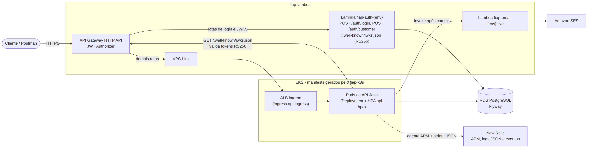

# fiap-application

API da oficina mecânica: clientes, veículos, estoque, serviços, orçamentos e ordens de serviço. As tabelas do PostgreSQL são versionadas pelo Flyway.

📚 **[Documentação principal — fiap-docs](https://github.com/FIAP-GRUPO05/fiap-docs)**

## Tecnologias e requisitos

Java 21, Spring Boot 3.5, Gradle Wrapper, PostgreSQL, Flyway, Docker, Kubernetes e New Relic. Para executar localmente, use Docker com Compose v2; para testes fora do container, instale JDK 21. Git e GitHub CLI autenticado permitem contribuir e acompanhar a publicação.

## Arquitetura deste componente



Fonte editável: [`docs/arquitetura.mmd`](docs/arquitetura.mmd).

Este repositório contém apenas a API Java (código, Dockerfile, testes e o registro ECR em `infra/registry`). As demais peças do fluxo ficam em outros repositórios:

| Peça | Repositório |
| --- | --- |
| API Gateway HTTP API, JWT Authorizer, VPC Link, Lambda de autenticação (`fiap-auth-<ambiente>`) e Lambda de e-mail (`fiap-email-<ambiente>`) | [fiap-lambda](https://github.com/FIAP-GRUPO05/fiap-lambda) |
| Deployment, Service, Ingress (ALB interno) e HPA da API no EKS, gerados por `infra/platform/scripts/deploy_application.py` e aplicados via CodeBuild | [fiap-k8s](https://github.com/FIAP-GRUPO05/fiap-k8s) |

O API Gateway encaminha `POST /auth/login`, `POST /auth/customer`, `GET /.well-known/openid-configuration` e `GET /.well-known/jwks.json` para a Lambda de autenticação; as demais rotas seguem pelo VPC Link até o ALB interno e os pods da API. O HPA escala por CPU (70%): 1 a 2 réplicas em develop/homol e 2 a 4 em prod.

## Executar e testar localmente 

Na raiz do repositório, em PowerShell:

```powershell
Copy-Item .env.example .env
# Defina DB_PASSWORD e JWT_SECRET no .env; use pelo menos 32 caracteres no JWT_SECRET.
docker compose up --build -d postgres mailhog backend
docker compose ps
./gradlew.bat clean build jacocoTestCoverageVerification --no-daemon
```

API: http://localhost:8080 · [Swagger local](http://localhost:8080/swagger-ui/index.html) · [OpenAPI local](http://localhost:8080/v3/api-docs) · [Collection Postman](CURL/oficina-mecanica.json) · MailHog: http://localhost:8025.

O modo local padrão é SMTP para MailHog, sem enviar mensagens externas. Para o teste integrado com Lambda, inicie `compose.notifications.yaml` no `fiap-lambda` e execute:

```powershell
$env:FIAP_LOCAL_LAMBDA_TEST='true'
$env:AWS_ACCESS_KEY_ID='local'
$env:AWS_SECRET_ACCESS_KEY='local'
./gradlew.bat test --tests '*LambdaEmailDeliveryIntegrationTest' --no-daemon
```

Esse teste usa apenas o runtime Docker em `127.0.0.1:19000` e verifica os e-mails em `127.0.0.1:18025`. Na AWS, `MAIL_TIPE=LAMBDA` usa o alias `fiap-email-<ambiente>:live` com credenciais temporárias do pod. A regressão HTTPS usa `notification_test_email` autorizado, configurado em `FIAP_RUNTIME_CONFIG`.

O link de orçamento do e-mail abre somente a identificação por CPF. Consultar detalhes, aprovar ou recusar exige JWT e validação de que a OS pertence ao cliente; `USER`/`ADMIN` mantêm acesso operacional. O token fica apenas em memória no navegador, sem aparecer na URL ou no armazenamento local.

O teste opcional do navegador usa Node.js 22+ e Chrome/Edge, backend real com H2 e emissor CPF mockado: `$env:FIAP_BROWSER_TEST='true'; ./gradlew.bat test --tests '*BudgetAccessBrowserIntegrationTest' --no-daemon`. O teste padrão de autorização não precisa de navegador ou AWS.

A [Collection Postman](CURL/oficina-mecanica.json) (formato Postman Collection v2.1) cobre os módulos de autenticação, cadastros, estoque e ordens de serviço. Para usar: no Postman, **Import** → selecione `CURL/oficina-mecanica.json`; ajuste a variável de coleção `baseUrl` (padrão `http://localhost:8080`, ou a URL da API do ambiente na tabela abaixo) e execute `Auth > Login`, que grava o `accessToken` na variável `token` usada pelas demais requisições.

Para encerrar o ambiente da aplicação: `docker compose down`. No Linux/macOS, use `cp` e `./gradlew` no lugar de `Copy-Item` e `./gradlew.bat`.

## Deploy e ambientes

O fluxo é `feature/* → develop → release/vX.Y.Z → prod → main`. O ambiente de destino de cada publicação é definido no job `publish` de `.github/workflows/pipeline.yml`:

| Branch | Ambiente | Namespace no EKS |
| --- | --- | --- |
| `develop` | Develop | `develop` |
| `release/vX.Y.Z` | Homologação | `homol` |
| `prod` | Produção | `prod` |
| `main` | Nenhum: apenas consolida a versão (PR `prod → main`, sem build nem deploy) | — |

Após o push da feature e o sucesso da CI, o PR é aberto automaticamente; os merges são manuais. Os próximos PRs são gerados após a promoção aprovada. `develop`, `release/*` e `prod` publicam no ambiente correspondente quando a infraestrutura está `active`; `prod → main` apenas consolida a versão.

Em `destroyed`/`destroying`, deploys e promoções ficam bloqueados. Em `maintenance`, a CI permite validar e promover código, mantendo os deploys bloqueados. O bootstrap administrativo usa AWS CLI; a operação diária do CI usa OIDC e não exige credenciais AWS de cada integrante.

Na CI, a aplicação executa build, testes, cobertura mínima de 90%, verificações de segurança e configuração de observabilidade. O deploy publica uma imagem ECR identificada pelo commit, executa rollout privado via CodeBuild e verifica saúde, regressão HTTPS das operações OpenAPI e telemetria real. Checks externos dependem da infraestrutura ativa; resultados ignorados são identificados no resumo.

## API e URLs dos ambientes

Cada ambiente (develop, homologação e produção) tem seu próprio API Gateway. As URLs não ficam fixadas aqui porque mudam sempre que a infraestrutura é recriada. A configuração atual, usada pela CI, fica na variável `FIAP_RUNTIME_CONFIG` (campo `api_url` de cada ambiente):

```bash
gh api repos/FIAP-GRUPO05/fiap-lambda/actions/variables/FIAP_RUNTIME_CONFIG --jq .value
```

Em cada `api_url`, o Swagger fica em `/swagger-ui/index.html`, o OpenAPI em `/v3/api-docs` e a saúde em `/actuator/health`. Operações protegidas exigem `Authorization: Bearer <JWT>`.

### Autenticação: nuvem x execução local

- **Na nuvem**, `POST /auth/customer` (CPF) e `POST /auth/login` (e-mail e senha) são atendidas pela Lambda de autenticação do [fiap-lambda](https://github.com/FIAP-GRUPO05/fiap-lambda), não pela API Java. A Lambda emite tokens RS256; o JWT Authorizer do API Gateway valida o token e a API Java também o valida, pois o deploy define `JWT_ISSUER` e o Spring busca as chaves em `<JWT_ISSUER>/.well-known/jwks.json` (`SecurityConfig.jwtDecoder`), conferindo issuer e audience.
- **Localmente** (sem `JWT_ISSUER`), `POST /auth/login` da API Java emite um token HS256 assinado com `JWT_SECRET`, com issuer `"self"` (`JwtTokenService`). Esse token vale apenas na execução local e não é aceito nos ambientes da AWS.
- `POST /auth/register-account` é sempre atendida pela API Java (rota pública também na nuvem): cria o usuário e o cliente e devolve os dados da conta, sem token. O token é obtido em seguida pelo login.

## Observabilidade

Nos ambientes da AWS, o deploy ativa o perfil Spring `json-logs` e define `NEW_RELIC_APP_NAME=fiap-api-<ambiente>`; o agente New Relic Java envia APM e traces.

- **Logs JSON**: com o perfil `json-logs`, o `logback-spring.xml` usa `LogstashEncoder` e grava uma linha JSON por log no stdout, com o campo `service: fiap-api`, o MDC e os argumentos estruturados. O New Relic coleta esses logs do cluster. Sem o perfil (execução local e testes), o console padrão do Spring Boot é mantido.
- **Correlação**: o `CorrelationIdFilter` reaproveita o header `X-Correlation-Id` recebido (até 64 caracteres `[A-Za-z0-9._-]`) ou gera um UUID, devolve o mesmo header na resposta e coloca `correlationId`, `trace.id` e `span.id` no MDC. Assim os logs da requisição ficam ligados ao trace distribuído no New Relic.
- **Evento customizado `ServiceOrderStatusChanged`**: gravado após o commit de cada mudança de status da ordem de serviço (`ServiceOrderStatusMetricsListener`), com os atributos `serviceOrderId`, `previousStatus`, `newStatus`, `timeInPreviousStatusSeconds`, `correlationId` e `appName` (atributos nulos são omitidos). Os dashboards provisionados pelo [fiap-k8s](https://github.com/FIAP-GRUPO05/fiap-k8s) usam esse evento nos painéis "Volume diário de ordens de serviço abertas" e "Tempo médio de execução por status (min)".

## Membros da equipe

<table>
  <tr>
    <td align="center" width="160">
      <a href="https://www.linkedin.com/in/wesslima/" title="Wesley Lima">
        <br>
        <sub><b>Wesley Lima</b></sub>
      </a><br><sub>Backend Engineer</sub>
    </td>
    <td align="center" width="160">
      <a href="https://www.linkedin.com/in/tim-morgenstern-4581911b1/" title="Tim Morgenstern">
        <br>
        <sub><b>Tim Morgenstern</b></sub>
      </a><br><sub>Backend Engineer</sub>
    </td>
    <td align="center" width="160">
      <a href="https://www.linkedin.com/in/matheus-pitas-baptista/" title="Matheus Pitas Baptista">
        <br>
        <sub><b>Matheus Pitas Baptista</b></sub>
      </a><br><sub>Backend Engineer</sub>
    </td>
  </tr>
</table>
