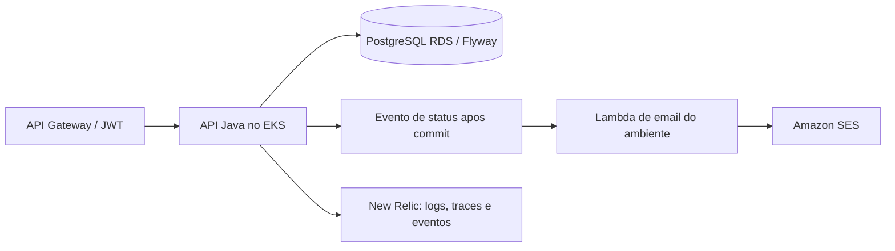

# fiap-application

API da oficina mecânica: clientes, veículos, estoque, serviços, orçamentos e ordens de serviço. As tabelas do PostgreSQL são versionadas pelo Flyway.

📚 **[Documentação principal — fiap-docs](https://github.com/FIAP-GRUPO05/fiap-docs)**

## Tecnologias e requisitos

Java 21, Spring Boot 3.5, Gradle Wrapper, PostgreSQL, Flyway, Docker, Kubernetes e New Relic. Para executar localmente, use Docker com Compose v2; para testes fora do container, instale JDK 21. Git e GitHub CLI autenticado permitem contribuir e acompanhar a publicação.

## Arquitetura deste componente



## Executar e testar localmente

Na raiz do repositório, em PowerShell:

```powershell
Copy-Item .env.example .env
# Defina DB_PASSWORD e JWT_SECRET no .env; use pelo menos 32 caracteres no JWT_SECRET.
docker compose up --build -d postgres mailhog backend
docker compose ps
./gradlew.bat clean build jacocoTestCoverageVerification --no-daemon
```

API: http://localhost:8080 · [Swagger local](http://localhost:8080/swagger-ui/index.html) · [OpenAPI local](http://localhost:8080/v3/api-docs) · [Postman](CURL/oficina-mecanica.json) · MailHog: http://localhost:8025.

O modo local padrão é SMTP para MailHog, sem enviar mensagens externas. Para o teste integrado com Lambda, inicie `compose.notifications.yaml` no `fiap-lambda` e execute:

```powershell
$env:FIAP_LOCAL_LAMBDA_TEST='true'
$env:AWS_ACCESS_KEY_ID='local'
$env:AWS_SECRET_ACCESS_KEY='local'
./gradlew.bat test --tests '*LambdaEmailDeliveryIntegrationTest' --no-daemon
```

Esse teste usa apenas o runtime Docker em `127.0.0.1:19000` e verifica os e-mails em `127.0.0.1:18025`. Na AWS, `MAIL_TIPE=LAMBDA` usa o alias `fiap-email-<ambiente>:live` com credenciais temporárias do pod. A regressão HTTPS usa `notification_test_email` autorizado, configurado em `FIAP_RUNTIME_CONFIG`.

Para encerrar o ambiente da aplicação: `docker compose down`. No Linux/macOS, use `cp` e `./gradlew` no lugar de `Copy-Item` e `./gradlew.bat`.

## Deploy e ambientes

O fluxo é `feature/* → develop → release/vX.Y.Z → prod → main`. Após o push da feature e o sucesso da CI, o PR é aberto automaticamente; os merges são manuais. Os próximos PRs são gerados após a promoção aprovada. `develop`, `release/*` e `prod` publicam no ambiente correspondente quando a infraestrutura está `active`; `prod → main` apenas consolida a versão.

Em `destroyed`/`destroying`, deploys e promoções ficam bloqueados. Em `maintenance`, a CI permite validar e promover código, mantendo os deploys bloqueados. O bootstrap administrativo usa AWS CLI; a operação diária do CI usa OIDC e não exige credenciais AWS de cada integrante.

Na CI, a aplicação executa build, testes, cobertura mínima de 90%, verificações de segurança e configuração de observabilidade. O deploy publica uma imagem ECR identificada pelo commit, executa rollout privado via CodeBuild e verifica saúde, regressão HTTPS das operações OpenAPI e telemetria real. Checks externos dependem da infraestrutura ativa; resultados ignorados são identificados no resumo.

## API e URLs dos ambientes

URLs verificadas em 28/10/2026, com saúde `UP` e regressivo das 53 operações OpenAPI aprovado em cada ambiente:

| Ambiente | API | Swagger |
| --- | --- | --- |
| Develop | [API](https://ku4upcna7k.execute-api.sa-east-1.amazonaws.com) | [Swagger](https://ku4upcna7k.execute-api.sa-east-1.amazonaws.com/swagger-ui/index.html) |
| Homologação | [API](https://ryzzw5lm77.execute-api.sa-east-1.amazonaws.com) | [Swagger](https://ryzzw5lm77.execute-api.sa-east-1.amazonaws.com/swagger-ui/index.html) |
| Produção | [API](https://khha99ce86.execute-api.sa-east-1.amazonaws.com) | [Swagger](https://khha99ce86.execute-api.sa-east-1.amazonaws.com/swagger-ui/index.html) |

Uma reconstrução pode gerar novos endereços. A configuração usada pela CI é consultada com:

```powershell
gh api repos/FIAP-GRUPO05/fiap-lambda/actions/variables/FIAP_RUNTIME_CONFIG --jq .value
```

Em cada `api_url`, o Swagger fica em `/swagger-ui/index.html`, o OpenAPI em `/v3/api-docs` e a saúde em `/actuator/health`. A autenticação CPF usa `POST /auth/customer`; operações protegidas exigem `Authorization: Bearer <JWT>`.

## Membros da equipe

<table>
  <tr>
    <td align="center" width="160">
      <a href="https://www.linkedin.com/in/wesslima/" title="Wesley Lima">
        <br>
        <sub><b>Wesley Lima</b></sub>
      </a><br><sub>Backend Engineer</sub>
    </td>
    <td align="center" width="160">
      <a href="https://www.linkedin.com/in/tim-morgenstern-4581911b1/" title="Tim Morgenstern">
        <br>
        <sub><b>Tim Morgenstern</b></sub>
      </a><br><sub>Backend Engineer</sub>
    </td>
    <td align="center" width="160">
      <a href="https://www.linkedin.com/in/matheus-pitas-baptista/" title="Matheus Pitas Baptista">
        <br>
        <sub><b>Matheus Pitas Baptista</b></sub>
      </a><br><sub>Backend Engineer</sub>
    </td>
  </tr>
</table>
